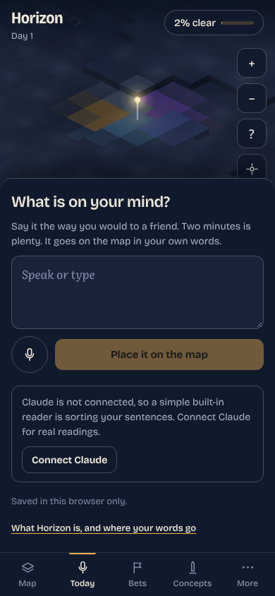
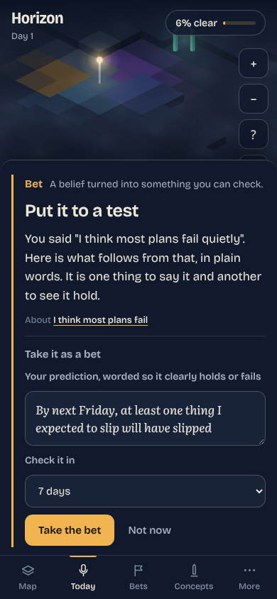
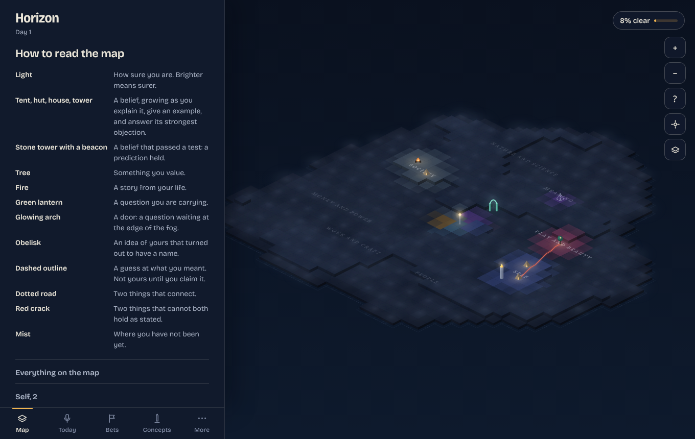

# Horizon

Talk to it for two minutes a day. It builds a map of how you think, in your own words, and shows where that map is solid, thin, untested, or at odds with itself.

**Try it:** https://aviralgupta2211.github.io/horizon/

Horizon is an early prototype (version 0.2, November 2026) and a working title. It runs entirely in your browser. There is no account and no server.

<p>
  
  
</p>
<p></p>

The screenshots come from the automated test run, with made-up entries.

## What it does

- **A daily entry.** You speak or type what is on your mind. Horizon pulls out the separate things you said and places each one on an island: beliefs, values, questions, stories.
- **Your words only.** Something counts as yours only if it is a quote of what you said. Anything reworded stays a dashed outline until you claim it. This is checked in code, not left to the model.
- **One move back.** Each entry gets exactly one of six replies: *Name it* (your idea has a name), *Bridge* (two things you said are the same idea), *Rift* (two things you said cannot both hold), *Counter* (the strongest opposing view), *Door* (a question into a part of your world you rarely visit), or *Bet* (a prediction you can check).
- **Depth comes from testing.** Saying something makes a tent. Explaining it, giving an example and answering the strongest objection make it grow. Only a prediction that holds turns it to stone.
- **Around that:** bets with due dates, a collection of named concepts, a five-question expedition into one region, a way to compare your map with a friend's, a fly-through film of your map, and a "brain lens" that is always marked as an estimate.

It does not praise you, diagnose you, or tell you what to believe. Nothing decays when you are away.

## Using it

1. Open the link above and say something. With no setup, a simple built-in reader sorts your sentences onto the map. It only matches words, so its replies are basic.
2. For real readings, connect Claude: **More > Claude**, then paste your own Claude API key. You create one in the [Claude Console](https://platform.claude.com/settings/keys). Choose one workspace for the key when you create it. If you do not, Horizon will ask for a workspace ID, which is listed on the Console's [Workspaces page](https://platform.claude.com/settings/workspaces).
3. On a phone, add the page to your home screen so it opens like an app.

**What a key costs you.** Anthropic bills your account for each reading. Going by the size of the prompt, a daily entry should cost about one to four US cents with the default model, at the prices published on 17 November 2026 (Claude Sonnet 5.5: $2 per million input tokens, $10 per million output tokens). That is an estimate and has not been measured on real calls yet. You can cap spending in the Console, and change the model under **More > Claude > Advanced**.

## Where your words go

| | |
|---|---|
| **Your map** | Stays in this browser, on this device. It is not uploaded anywhere and will not follow you to another device. Save a copy now and then under **More > Your data**. |
| **Claude** | Off until you connect a key. Once connected, each entry is sent to Anthropic's API together with part of your existing map (up to 60 items), so Claude can link new things to old ones. Anthropic's terms for your key apply. |
| **Your key** | Kept in this browser's storage. It is sent to `api.anthropic.com` and nowhere else, and it is only stored after Claude has answered with it once. **Forget this key** removes it. Do not connect on a shared computer: anyone using the same browser profile can use a stored key. |
| **Dictation** | Off until you turn it on, and it asks first. It uses your browser's speech recognition, which in most browsers sends your voice to the browser's maker (Google for Chrome, Apple for Safari) to be turned into text. |
| **Reading aloud** | Uses your browser's voices, and picks one that runs on the device when the browser lists one. |
| **Sharing** | Nothing is shared unless you make a share code under **Together** and send it to someone yourself. The code contains what you placed in the regions you ticked. |
| **This site** | Is served by GitHub Pages, which sees the usual details of a page request, such as your IP address. Horizon has no analytics, no trackers and no cookies. Fonts and scripts are served from this site only. |

When the page runs as a website it sets a content security policy on itself before anything else loads: no script from anywhere else, no inline script, and network requests to `api.anthropic.com` only. It is in `js/env.js`, and the tests check that it holds.

One limit to know about: every page published under the same `github.io` address shares browser storage. Before Horizon is used widely it should move to an address of its own.

## What it is not

Horizon maps ideas. It is not therapy, advice or a diagnosis, and nobody reads what you write. If an entry sounds like a crisis, Horizon answers with a short note and places nothing on the map. If you are in danger or thinking about harming yourself, contact your local emergency number or a crisis line. [Find A Helpline](https://findahelpline.com) lists them by country.

## Status

What works today is listed above. What you should know before relying on it:

- **Not yet run against the real Claude API.** As of 17 November 2026 the calls were written from Anthropic's documentation and tested against a local stand-in that follows it. If connecting fails for you, please open an issue and include the message the app shows.
- **Only Chrome was automated.** Safari, Firefox, and dictation and reading aloud on real phones have not been checked.
- **One browser, one map.** No sync between devices. A browser can clear a site's storage on its own, and Safari can do so after about a week without a visit unless the page is on your home screen. On an iPhone, the home-screen copy keeps a separate map from Safari. Move a map with **Save a copy** and **Bring a copy back**.
- **The built-in reader is crude,** and its check for crisis language is a short list of English phrases.
- **The brain lens in the app is an estimate made from the words.** The real version is `tools/tribe_lens.py` (see below). Its calls into the model have not been executed.
- **The film** is a camera moving over your map with your words as captions. No video model is involved.
- The daily prompt has not been tuned on real entries. One island size. No realtime sync between two open tabs.

## Run it yourself

It is a static site with no build step.

```
git clone https://github.com/AviralGupta2211/horizon.git
cd horizon
python3 -m http.server 8000
```

Then open http://localhost:8000. Serve it over http rather than opening the file directly.

### Publishing the site

The code lives on `main`. The public site is served by GitHub Pages from the `gh-pages` branch, which holds only the files the page needs (`index.html`, `css/`, `js/`, `fonts/`, `icons/`, the manifest). After pushing a change to `main`, publish it with:

```
sh tools/publish-site.sh
```

GitHub takes a minute or two to put it live.

## Checks

```
npm install
CHROME=/path/to/chrome npm test
python3 tools/tribe_lens.py --self-test
```

`npm test` runs 75 checks: 15 on the logic, 6 on reading the API's replies and errors, and 54 that drive the real page in headless Chrome. The browser checks need Chrome (or Chromium) and `openssl`; without `openssl` the 14 checks that use the API stand-in are skipped. They use two stand-ins, both in `test/`: one for the Claude runtime, and one for the Claude API, a local server that Chrome is pointed at in place of `api.anthropic.com` so that the page's real request code, the browser's cross-origin checks and the page's security policy are all exercised. No test talks to Anthropic or needs a key.

## How it is put together

| Path | What it holds |
|---|---|
| `index.html`, `css/`, `fonts/`, `icons/`, `manifest.webmanifest` | The page, its styles, its two typefaces and its icons |
| `js/env.js` | Works out where the page is running and supplies the same services either way: asking Claude, dictation, reading aloud, saving a file. Holds the security policy and all handling of the API key |
| `js/core.js` | All the logic, with no page code: the island, placement, fog, the prompts, validation of what the model returns, state changes, share codes |
| `js/world.js` | The canvas renderer and camera |
| `js/store.js` | Saving and loading |
| `js/app.js` | The panels, the daily loop and the wiring |
| `test/` | The checks and their stand-ins |
| `tools/tribe_lens.py` | The real brain lens |
| `tools/make-icons.js` | Renders the icon sizes from `icons/icon.svg` |
| `tools/publish-site.sh` | Puts the site's files on the `gh-pages` branch and pushes it |

The prompts and the validation of replies are in `js/core.js` (`dailyPrompt`, `normalizeDaily`, `challengePrompt`, `expeditionPrompt`, `overlayPrompt`). Nothing the model returns is trusted: every field is checked, clipped and typed before it touches the map.

### Inside Claude

The same files also run as a Claude artifact. There the Claude runtime supplies Claude, dictation, speech and a private database, so no key is needed and `js/env.js` steps aside. Version 0.1 was published that way. Version 0.2 has not been.

### The real brain lens

Meta's TRIBE v2 predicts how an average brain responds to speech. It does not measure your brain, and it cannot show where a belief lives. It needs a GPU and its licence is non-commercial (CC BY-NC 4.0), so it runs outside the page.

1. In the app: **More > Brain lens > Copy the input for the script**. Save it as `horizon_lens_input.json`.
2. On a GPU machine, follow the setup at the top of `tools/tribe_lens.py`, then run `python tribe_lens.py horizon_lens_input.json --out horizon_lens.json`.
3. Paste the contents of `horizon_lens.json` back into the app under **More > Brain lens**.

## Feedback

Tell us what worked and what did not: [open an issue](https://github.com/AviralGupta2211/horizon/issues/new). If you have found a security problem, open an issue that says so without the details, and ask for a private way to send them.

## Rights

No licence has been chosen yet. Until one is added, all rights are reserved by the repository owner: you are welcome to use the hosted app and to read the code, but this does not give permission to copy, change or redistribute it.

- The typefaces in `fonts/` are Bricolage Grotesque and Literata, each under the SIL Open Font License 1.1. The licence texts are in that folder.
- TRIBE v2 is by Meta and is not included here.
- Horizon is an independent project. It is not made or endorsed by Anthropic or Meta. Claude is Anthropic's product.
